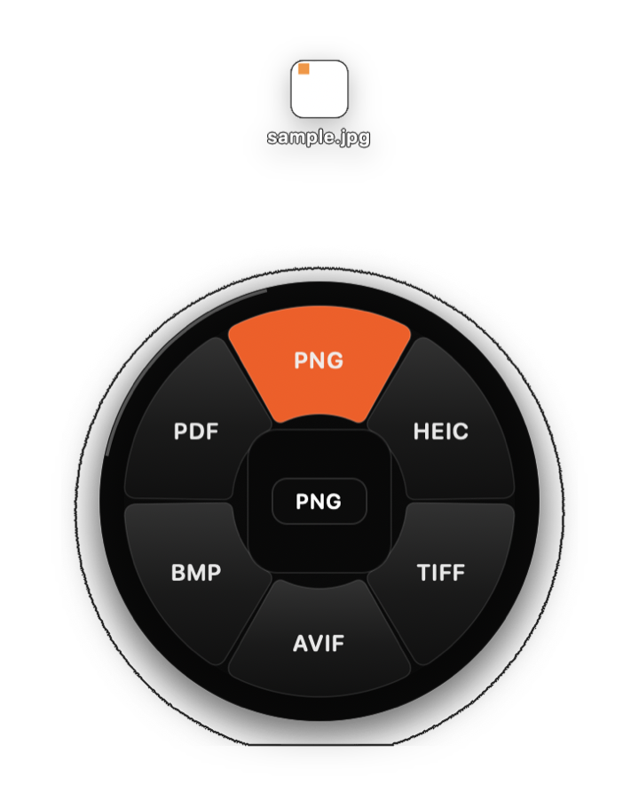
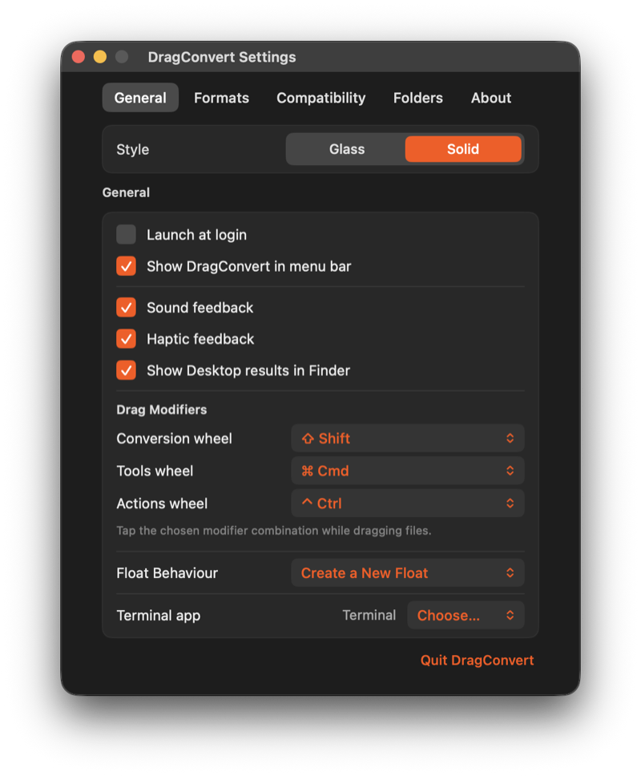
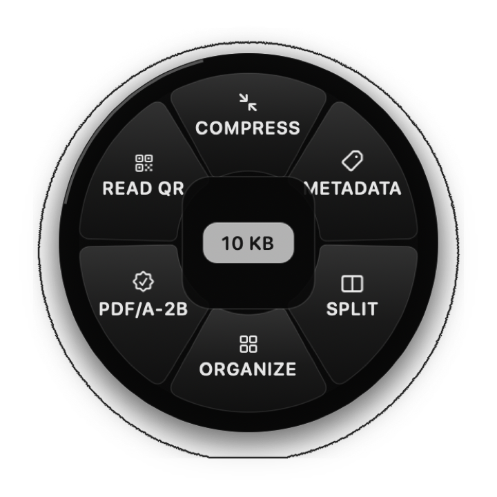
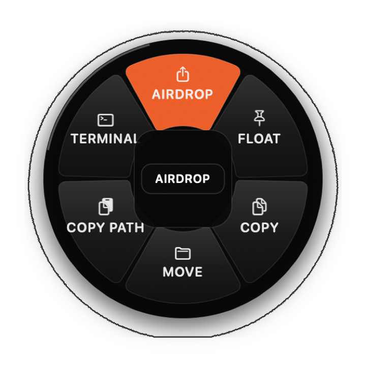
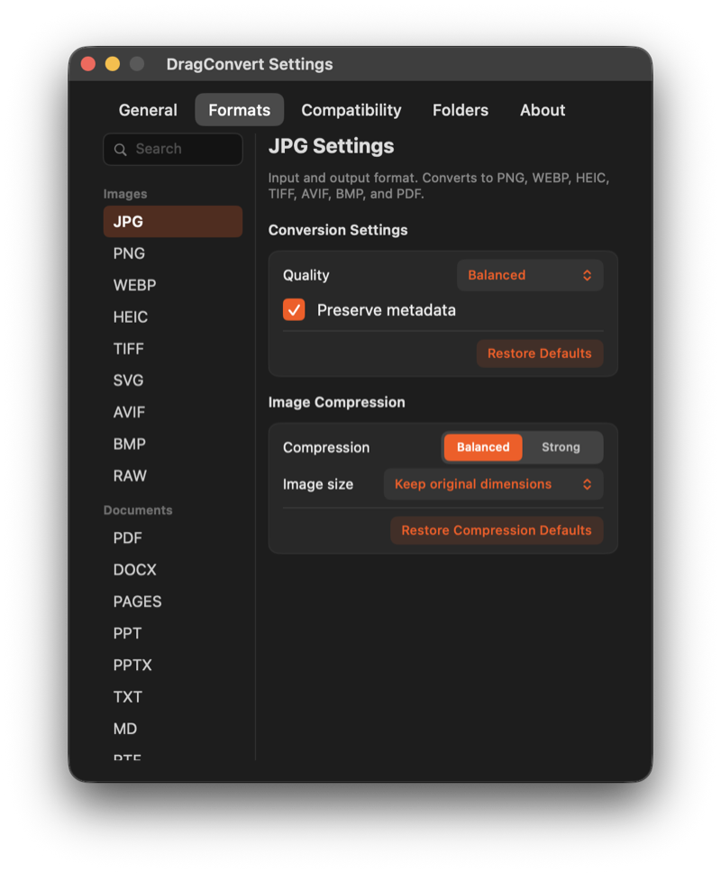
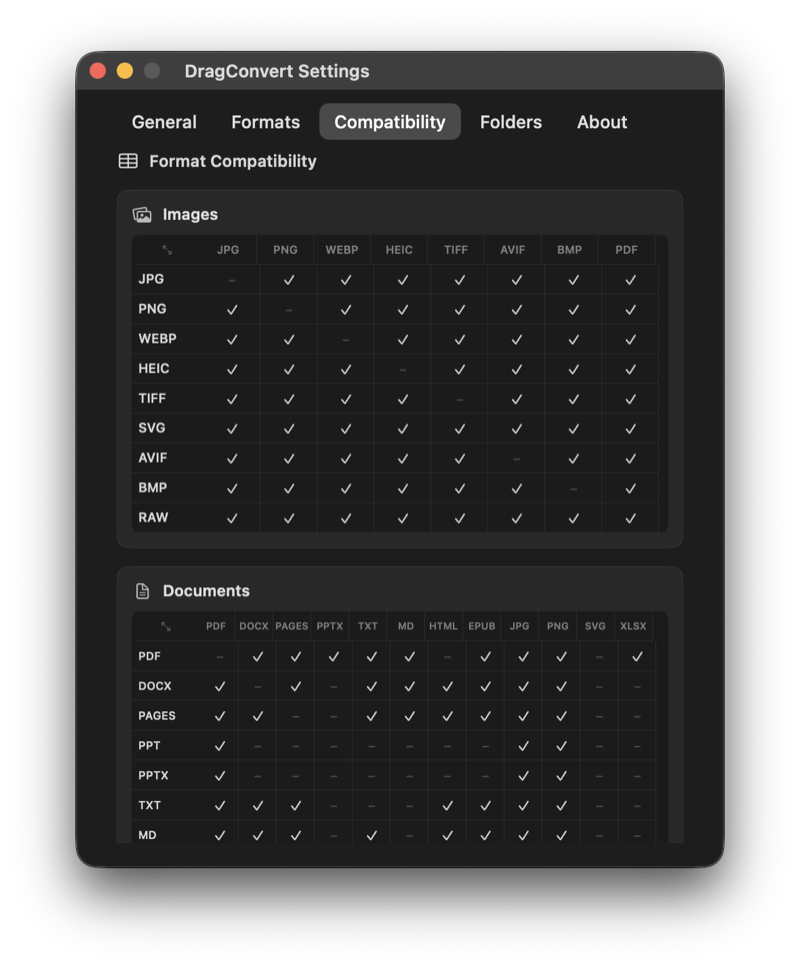

<p align="center">
  
</p>

<h1 align="center">DragConvert</h1>

<p align="center">
  <strong>Convert, edit, and manipulate files mid-drag from a radial wheel directly at your cursor.</strong><br>
  100% free, open-source (GPL-3.0), local-first, and lightning fast. No subscriptions, no telemetry, no cloud uploads.
</p>

<p align="center">
  <a href="LICENSE"></a>
  <a href="https://apple.com/macos"></a>
  <a href="https://swift.org"></a>
  <a href="#"></a>
  <a href="#"></a>
  <a href="#"></a>
</p>

---

<p align="center">
  
</p>

## Why DragConvert?

Every day on macOS, we switch apps, fiddle with export menus, or upload confidential documents to random web converters just to resize an image, convert a PDF, extract text, or strip camera metadata.

**DragConvert ends the friction.**

Just drag any file in Finder, tap a modifier key, and a fluid radial wheel blooms right under your cursor. Flick to a wedge and release. Your converted or edited file appears instantly **right beside the original**—with zero quality loss, zero telemetry, and zero context switching.

```
Drag file in Finder ──> Tap ⇧ / ⌥⌘ / ⌃⌘ ──> Wheel appears anchored ──> Release on wedge ──> Done!
```

---

## The Three Wheels

Customizable shortcuts let you summon three distinct, context-aware radial wheels on demand:

| Wheel | Trigger | What it does |
|---|---|---|
| **Convert** | <kbd>⇧ Shift</kbd> | Instant format conversion (JPG, PNG, HEIC, TIFF, AVIF, BMP, PDF, TXT, Markdown). |
| **Tools** | <kbd>⌥⌘ Option + Command</kbd> | Six primary tools per file: Compress, Metadata, Split, Organize, PDF/A-2B and Read QR for PDFs; Compress, Crop, Resize, Rotate, Redact and Metadata for images. Multi-selection adds Merge/Collage. |
| **Actions** | <kbd>⌃⌘ Control + Command</kbd> | Utility workflows: AirDrop, Floating Shelf, Copy to Clipboard, Move, Copy Path, Open in Terminal/iTerm2. |

> **Sticky Wheel:** No need to hold down keyboard shortcuts while dragging. Tap the modifier key once and release—the wheel stays pinned until you drop or press <kbd>Esc</kbd>.

---

## Key Features

### 🎯 Mid-Drag Format Conversion (`⇧ Shift`)
* **Images**: Convert between **JPG, PNG, HEIC, TIFF, BMP, and AVIF**.
* **Images → Single PDF**: Drop a multi-image selection onto the PDF wedge to instantly stitch them into an ordered, multi-page document.
* **PDF → Raster**: Renders every page of a PDF into crisp, individual **300 DPI** images (JPG, PNG, TIFF).
* **PDF → Text & Markdown with On-Device OCR**: Extracts clean selectable text streams, falling back to local **Apple Vision OCR** for scanned documents.
* **Smart Mixed Selections**: Drop mixed file types (e.g., HEIC + PNG); the wheel dynamically calculates their common target formats. Files already matching the target are safely skipped.

### 🛠️ In-Place Pro Tools (`⌥⌘ Option + Command`)
* **Precision Crop & Batch Crop**: 8-handle interactive crop panel with aspect ratio presets (`Free`, `1:1`, `16:9`, `9:16`, `4:3`, `3:4`) and live pixel dimensions. Batch-crop an entire selection with one normalized framing. The tools wheel keeps six primary tools per file; multi-file selections add Merge (PDFs) and Collage (images).
* **Instant Background Removal**: Runs Apple Vision foreground segmentation on-device via the Neural Engine. Exports a clean, transparent PNG in milliseconds.
* **Smart Compression**: Target an exact file size (e.g. *"Hit exactly 500 KB"*) or pick a quality percentage. Iterative search never inflates files that are already small.
* **True Content Redaction**: Not just visual black boxes—flattened, destructive pixel wipe for both Images and PDFs. Underlying text and vectors are physically destroyed.
* **Complete PDF Workbench**:
  * **Merge**: Seamlessly merges multiple PDFs in the exact order you dragged them.
  * **Split**: Split by page numbers or into $N$ equal parts in an organized subfolder.
  * **Organize**: Visual thumbnail grid to drag-to-reorder, rotate in 90° increments, duplicate, or delete individual pages.
  * **Compress**: Choose between *Balanced* (keeps vector text intact) or *Target Size* modes.
  * **Crop**: Crop every page of a document simultaneously from one visual selection.
* **Add Background & Frame**: Canvas framing with customizable padding, drop shadows, corner radii, solid colors, or source image background blurs.
* **Vector Annotations**: Markup photos and PDFs with arrows, rectangles, ellipses, text, and freehand ink with customizable line weights and colors.
* **Photo Adjustments**: Live sliders for Brightness, Contrast, Saturation, and Warmth.
* **Collage Maker**: Build clean Grid, Row, Column, or Featured hero collages from multiple images.
* **Metadata Viewer & Stripper**: Inspect camera models, EXIF, IPTC, and GPS data, with a single-click clean strip for web sharing.
* **QR Code Scanner**: Decodes barcodes and QR codes on-device with immediate clipboard copy or one-click URL opening.

### ⚡ Instant File Actions (`⌃⌘ Control + Command`)
* **AirDrop**: Sends selection immediately via the macOS sharing service.
* **Floating Shelf**: Park files on a discreet floating desktop shelf to drag into Slack, emails, or other apps later.
* **Copy to Clipboard**: Places real file URLs directly on your system clipboard for native Finder pasting.
* **Move to Folder**: Quick destination directory picker.
* **Copy Path**: Copies newline-separated POSIX file paths.
* **Open in Terminal**: Launches the current directory in Terminal.app, iTerm2, or your configured terminal.

---

## Built for Power Users

<p align="center">
  
</p>

| Conversion wheel | PDF tools | Actions |
|---|---|---|
|  |  |  |

| General settings | Formats | Compatibility |
|---|---|---|
|  |  |  |

* **Full Keyboard Navigation**:
  * <kbd>1</kbd>–<kbd>9</kbd>: Instantly picks a numbered wedge.
  * <kbd>←</kbd> <kbd>→</kbd> <kbd>↑</kbd> <kbd>↓</kbd>: Cycles through options.
  * <kbd>Return</kbd>: Executes hovered tool.
  * <kbd>Esc</kbd>: Dismisses the wheel.
  * *Prevents accidental drops*: When activated via keyboard, the panel stays locked to absorb Finder’s pending mouse-up.
* **Glass and Solid Styles**: Two wheel materials — translucent dark glass with an orange hover, or opaque charcoal with a light hover. Switch them in Settings.
* **Tactile Feedback**: A soft 60 ms hover tick plus alignment haptics; separate sound and haptics toggles. The wheel blooms in 0.2 s and crossfades to `#FF5200` in Glass.
* **File Header + Format Capsule**: The dragged file icon and name sit above the wheel; the centre capsule shows the target format as you move.
* **Non-Activating Floating Panel**: Never steals frontmost focus or interrupts your active workspace.
* **Atomic Writes & Collision Protection**: Writes via temporary files (`.<UUID>.tmp`) before swapping. Automatically uses smart collision naming (`sample 2.jpg`) so your original files are never overwritten.
* **Uncompromising Privacy**: Sandboxed with zero network entitlements. No phone-home telemetry, no analytics, no external servers.

---

## How It Compares

| Feature | DragConvert | Tangerine ($29.99) | Cloud Converters |
| :--- | :---: | :---: | :---: |
| **Price** | **Free & Open Source (GPL-3.0)** | $29.99 (20-file trial) | Subscription / Ad-supported |
| **Privacy** | **100% Local (0 Network Entitlement)** | Policy promise | Uploaded to remote servers |
| **Latency** | **< 80 ms (Hardware Accelerated)** | Micro-lags reported | Depends on upload/download speed |
| **Interaction** | **Radial Wheel + Keyboard (1–9)** | Radial Wheel | Drag into browser tab |
| **Architecture** | **Native Swift 6 + AppKit** | Native Swift | Web / Electron |
| **Compatibility** | **macOS 13+ (Apple Silicon & Intel)** | Apple Silicon only | Any browser |
| **Auditability** | **Full Source Available** | Closed Source | Closed Source |

---

## What’s new in 0.7.1

- **Exact three-wheel layout**: seven conversion wedges, six PDF tools in the reference order, six actions, file size in the centre and no overcrowding.
- **Opt+Cmd tools / Ctrl+Cmd actions** defaults, with the full modifier picker.
- **Full grouped Formats catalog** — Images, Documents, Spreadsheets, Audio, Video, Archives, Subtitles — with the reference per-format settings panels.
- **Format Compatibility matrix** for every group, with the reference columns, checkmarks and honest dashes.
- **Real WebP encoding**, PDF/A-2B export, Read QR for PDFs, subtitle conversion and ZIP/TAR/GZIP conversion.
- **Appearance section**, 30 pt content margins, compact rows, brown modifier pills and a fixed Quit footer in General.
- **Compact dark glass HUD** for progress, success and failure.

The format registry and settings are complete. Local conversion engines ship for images (including WebP, AVIF, RAW and SVG input), PDF (including PDF/A-2B and QR), subtitles and archives. Document, spreadsheet, audio and video engines are the next family and are marked accordingly in the app.

### Packaging fix in 0.7.1

- The app is now **universal** (Apple Silicon + Intel), not arm64-only.
- A signed **DMG** is published alongside the ZIP, with an Applications shortcut, a Read Me and a Gatekeeper fix command.
- The bundled `cwebp` helper is universal too.
- The DMG/ZIP are still ad-hoc signed rather than notarized because no Developer ID certificate is available in this build environment.

## Installation

### Option 1: Homebrew (Recommended)

On **Homebrew 7**, trust the tap once and install:

```bash
brew trust j4yop/tap && brew install --cask j4yop/tap/dragconvert
```

On older Homebrew versions this is enough:

```bash
brew install --cask j4yop/tap/dragconvert
```

The cask installs `DragConvert.app` into `/Applications` and clears the quarantine flag automatically, so you can open it right away. If macOS still asks for confirmation, use **System Settings → Privacy & Security → Open Anyway** once.

### Option 2: Build From Source

```bash
git clone https://github.com/j4yop/DragConvert.git ~/Developer/DragConvert
cd ~/Developer/DragConvert
make install
```

`make install` builds the app, signs it with entitlements, installs it to `/Applications/DragConvert.app`, and refreshes macOS LaunchServices so the orange wheel icon appears in Spotlight and Launchpad.

### Option 3: DMG (Manual Download)

Download the latest **`DragConvert-<version>.dmg`** from [Releases](https://github.com/j4yop/DragConvert/releases). Open it, drag `DragConvert.app` into Applications, and launch it. The DMG contains a Read Me and a **Fix Gatekeeper.command** helper.

The app is universal (Apple Silicon and Intel) and ad-hoc signed, but not notarized. If macOS says the app is damaged or cannot be opened, run:

```bash
xattr -dr com.apple.quarantine /Applications/DragConvert.app
open /Applications/DragConvert.app
```

You can also right-click the app and choose **Open** twice. A ZIP is still published for people who prefer it.

### Development Build

```bash
make run
```

Runs the application directly from the local `build/` directory.

### Live Diagnostic Logs

Curious what DragConvert sees mid-drag? Stream the real-time event pipeline:

```bash
make log
```

---

## Permissions & The App Sandbox

DragConvert is sandboxed from day one. When you drag a file into an app, macOS only grants access to that specific file—not its parent directory.

To allow DragConvert to write the converted result **right next to the original**, the app requests **Folder Access** once upon onboarding. This creates a secure, sandboxed, app-scoped bookmark stored locally in `UserDefaults`. DragConvert **never asks for Full Disk Access or Accessibility permissions**.

---

## Keyboard Reference

```
  [1] [2] [3] [4] [5] [6] [7] [8] [9]  ──> Jump directly to wedge
  [←] [→] [↑] [↓]                      ──> Cycle wedges clockwise / counter-clockwise
  [Enter / Return]                     ──> Confirm selection
  [Escape]                             ──> Cancel and dismiss wheel
```

---

## Tech Stack & Architecture

DragConvert is architected as modular Swift packages for speed, testability, and safety:

* **Swift 6 & Strict Concurrency**: Fully `@MainActor` UI with `Sendable` detached task execution.
* **DragSense**: Zero-permission 60 Hz pasteboard and modifier polling.
* **WheelUI**: Custom CoreGraphics/AppKit drawing engine for rounded annular sectors and specular highlights.
* **CapabilityGraph**: The "Truth Gate" that derives wedges strictly from verified engines.
* **JobCore**: Actor-based queue, atomic file replacement, and non-destructive naming policies.
* **Engines**: High-performance system frameworks—**ImageIO, CoreGraphics, PDFKit, and Apple Vision**.
* **57 Unit Tests**: Comprehensive coverage across format handling, redaction, compression, and math geometry.

---

## Roadmap

The core interaction loop and primary Image & PDF workflows are fully shipped. Upcoming priorities:

- [ ] **WebP & SVG Output**: Integrated WebP encoder and SVG vector rasterizer.
- [ ] **PDF/A-2b & PDF → Office**: PDF/A long-term archiving and honest DOCX/Pages conversion.
- [ ] **Optional Media Engine (FFmpeg)**: Modular, opt-in audio/video conversions and video editing tools.
- [ ] **Shortcuts & CLI Integration**: Trigger conversions and workflows without dragging.

See [PLAN.md](PLAN.md), [PARITY.md](PARITY.md), [TASKS.md](TASKS.md), and [docs/TANGERINE-GAP-REPORT.md](docs/TANGERINE-GAP-REPORT.md) for full engineering specifications and audit records.

---

## Contributing & License

Contributions, bug reports, and PRs are warmly welcomed! Please read [WORKFLOW.md](WORKFLOW.md) for our code standards, test fixtures, and quality gates.

DragConvert is free software, distributed under the **[GNU General Public License v3.0](LICENSE)** (GPL-3.0-only). You can use, study, share, and modify it; redistributed versions must remain free under the same licence. The complete corresponding source is this repository.

Relicensed from MIT to GPL-3.0 at **0.4.0**.
