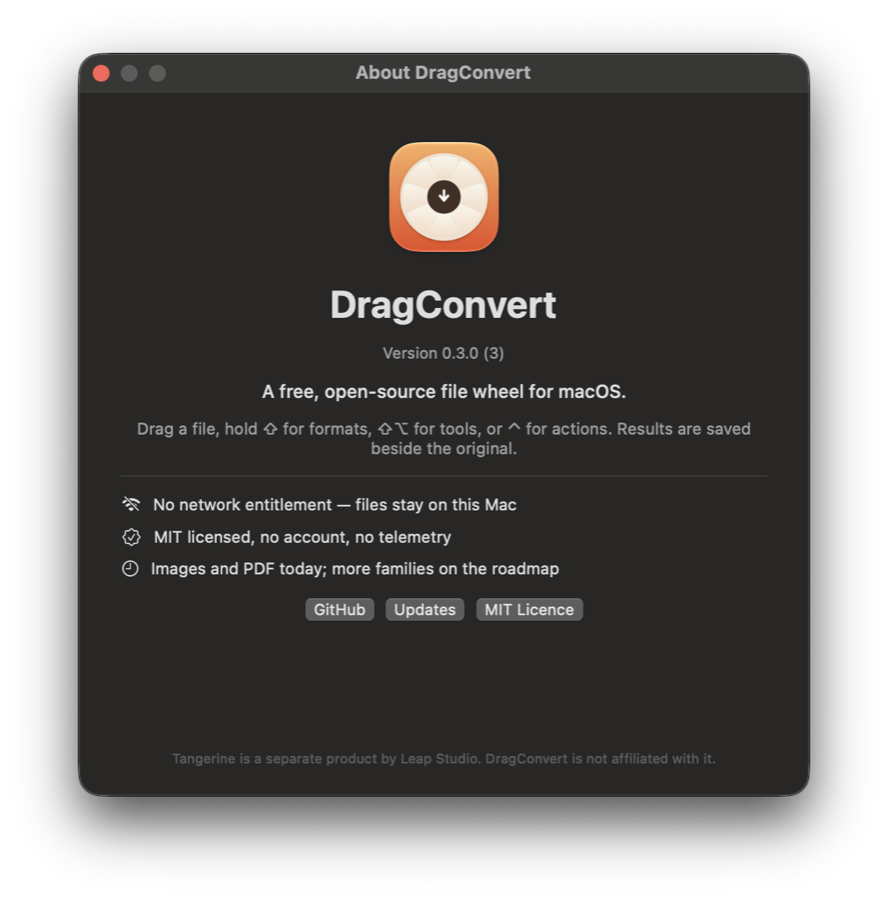

# DragConvert

A macOS utility that converts files mid-drag, from a radial wheel at the pointer.

**Free and open source (MIT).** No trial, no purchase, no account, no telemetry.
Every conversion runs locally on your Mac.

**Status: the core loop works.** A sandboxed app sees a Finder drag, shows the wheel, and writes the converted file beside the original.

## Run

```bash
cd ~/Developer/DragConvert
make run
```

Drag a file in Finder, hold **⇧**, move the pointer outward to a wedge, release.

```bash
make log     # drag / hover / drop / job — with full output paths
```

## What works

- Menu-bar app, sandboxed, ad-hoc signed
- Wheel appears on ⇧ / ⇧⌥ / ⌃, stays open after you release the key, and stays anchored
- **Sticky wheel:** tap the key once, release, choose at leisure; Escape cancels
- **Centre preview:** dragged-file thumbnail, filename and size pill
- **Mixed selections:** convert the formats every file shares; files already in the target are skipped
- Keyboard: 1–9 picks a wedge, arrows cycle, Return applies, Escape cancels
- Hover from the polled pointer; release fallback if the drag destination doesn't fire
- Progress HUD with running / success / failure states and cancel
- Batch selections: “3 of 5 saved”, stops on the first error
- Friendly errors for permission, disk full and missing files
- **Crop** with 8 handles, editable W/H, aspect presets, live pixel size, new file output
- **Resize + rotate/flip** with lock-aspect fields and a live preview
- **Compress** to a target KB or quality %, iterative, never inflates
- **Metadata** viewer (file, image, camera, dates, GPS) with one-click strip
- **PDF merge** in selection order, **split** at pages or equal parts, **organize** with a thumbnail grid, **compress** Balanced or to a target KB, **crop** all pages from one drag
- **Images → PDF** by dropping a multi-image selection on the convert wheel’s PDF target
- **Annotate PDF** with text, rectangles, ellipses, arrows and freehand ink, page by page
- **Redact PDF** with true content removal: pages are flattened and anything under a box is gone
- **Add BG** for images: padding, colour or image background, blur, rounded corners, shadow
- **Redact images** with black boxes, Undo and a pixel-replaced export
- **Annotate images** with the same text/shapes/ink tools as PDF
- **Batch crop** one relative crop across a whole selection
- **Collage** with grid, row, column and featured layouts
- **PDF Add BG** to frame every page on a colour or image canvas
- **Remove BG** via Vision’s on-device foreground mask → transparent PNG
- **Read QR** and copy the decoded value or open its link
- **Edit photos** with brightness, contrast, saturation and warmth + live preview
- **PDF → TXT/Markdown** with selectable text and local Vision OCR for scanned pages
- **AVIF export** (plus JPG/PNG/HEIC/TIFF/BMP/PDF)
- **App icon, template menu-bar wheel, About/privacy/licences, update link**
- **5-step capsule onboarding** with wheel demo, folder access and launch at login
- **File actions**: AirDrop, Float shelf, Copy (clipboard), Move, Copy Path, Terminal (Terminal/iTerm2 picker)
- **Settings**: wheel shortcuts, sound, hover haptics, reveal, terminal app, conflict policy, launch at login
- PDF → JPG/PNG/TIFF at 300 DPI, all pages
- Image → JPG/PNG/HEIC/TIFF/BMP/PDF
- Atomic writes, collision naming, 56 unit tests

Source: <https://github.com/j4yop/DragConvert> · Licence: [MIT](LICENSE)

## Screens

| Conversion wheel | Settings |
|---|---|
|  |  |



## Read in this order

| File | What it is |
|---|---|
| **[WORKFLOW.md](WORKFLOW.md)** | Cadence, quality gates, next week, decisions |
| **[TASKS.md](TASKS.md)** | Live backlog with IDs and acceptance criteria |
| **[PARITY.md](PARITY.md)** | Feature matrix: 9 families, ~270 paths, 26 tools |
| **[PLAN.md](PLAN.md)** | Architecture, stack, risks, schedule |

## Commands

```bash
make test
make run
make log
make convert file="/path/Page 001.pdf" to=jpg
make open      # needs: brew install xcodegen
```

## Next

The P0 interaction release is built: truthful wheel, sticky selection, ⇧⌥, Copy-to-clipboard, mixed selections, centre preview, AVIF, PDF text/OCR, app icon and packaging. Next are WebP/SVG encoding, PDF/A-2b and PDF→Office, the metadata editor and deeper photo/annotate/redact controls, then optional FFmpeg for audio/video. The full audit is in [`docs/TANGERINE-GAP-REPORT.md`](docs/TANGERINE-GAP-REPORT.md).
